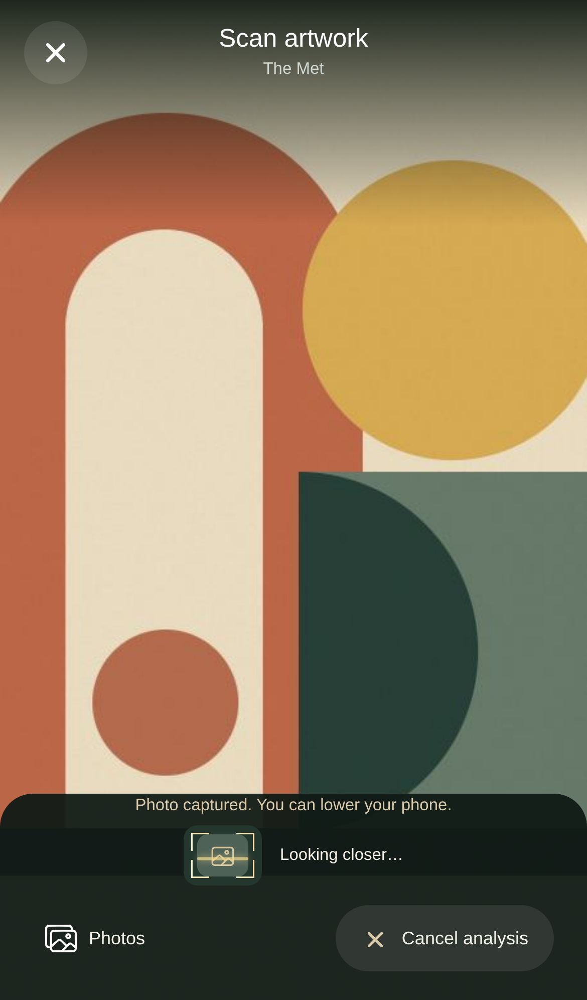

# Automatic capture · 2026-10-18

Scan now freezes a frame when fast image detection finds artwork, independently of whether the work has been identified. It closes the camera and continues recognition using that same frame. Unfamiliar works trigger one general-analysis request after capture. Known candidates still require the visitor to select the work before generating an interpretation.

The frozen photo remains visible after success, failure or cancellation. **Scan again** explicitly starts a new camera session. **Capture frame** provides manual capture when detection is uncertain; retries can reuse the photo. Browser frames remain in memory; native captures use temporary cache files, removed on replacement or screen unmount, without writing to the photo library.

## Real model/browser evidence

[Browser report](browser-real-models.json) records a camera stream showing an app artwork, real multipart uploads and actual OpenCLIP/Ollama inference. Neither HTTP requests nor model responses were mocked.

| Stage | Measured time |
| --- | ---: |
| Enter Scan → capture and camera tracks stopped | **669 ms** |
| Full analysis completed | 58,685 ms |

Exactly **one** live-frame recognition request and **one** general-analysis request were sent. All camera tracks ended before analysis finished. The simulated scene was then changed to black, while the retained photo remained unchanged. A later result did not restart the camera. These timings are individual cloud measurements, not a guarantee on other hardware.

## Detection and validation

The detector reuses the existing normalized CLIP image vector. Two offline text prototypes in the identical ViT-B-32 / laion2b_s34b_b79k space provide an artwork-versus-background scene cue. No extra model download, model generation or text tower is required at runtime. The exporter and prompts are checked in. Detection does not change identity thresholds, confirm an artwork or broaden the reference catalogue.

- **22/22 real HTTP controls** pass: 15 museum references, an unfamiliar artwork, two framed variants, two exterior photographs and black/white controls. See [results](detection-http.json).
- **107 AI tests**, **71 core tests** and **5 mobile test files** pass. Suites overlap.
- **21 browser regressions** pass, including freezing before a delayed response, stopping all tracks, no second sample, cancellation, failure, manual capture and explicit rescan. Two opt-in live tests are skipped in that mocked run; the real auto-capture test passes separately.
- Mobile TypeScript and Web/iOS/Android exports pass. Physical iOS/Android cameras were unavailable in this cloud environment; native lifecycle checks and builds do not establish device-camera accuracy.

The labelled controls are small and mostly bundled/synthetic. No general scene-detection accuracy or false-positive rate is established. A poor view can require manual capture or a retake. Slow general vision and uncertain artwork identity remain possible, but the visitor no longer needs to hold the camera during that work.

After updating, stop the old backend and Expo terminals, then run `npm.cmd start`. Recognition version 2 prevents silent reuse of the old continuous-scan backend. To repeat the controlled HTTP checks, keep the app running and use `npm.cmd run ai:validate:capture` in another terminal. Models and reference indexes do not need retraining for this change.
